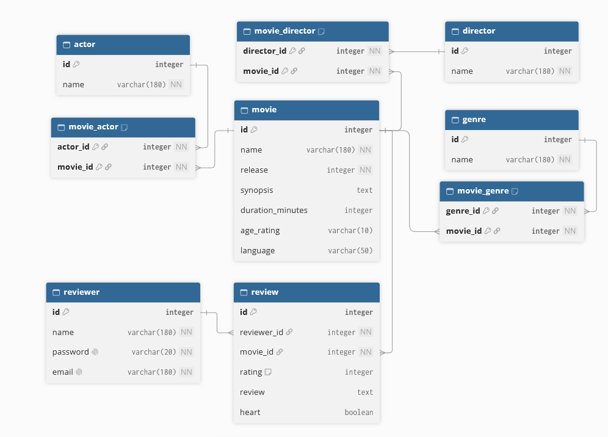

## Cartacaixado:

Um site para feito para a catalogação e critica de filmes(levissímas inspirações no letterboxd)

## Linguagens:

HTML5
CSS3
JavaScript
SQL

## Tecnologias:

Supabase (PostgreSQL)
Biblioteca supabase-js

## Funcionalidades:

1. Lista de filmes com filtro por gênero e por ano
2. Página do filme com sinopse, duração, classificação, idioma, diretores, atores e gêneros
3. Criar conta e login (o usuário logado fica salvo no `localStorage`)
4. Reviews: criar, editar e excluir, com nota de 0 a 10 e opção de favoritar (coração)

## Como rodar

1. Crie um projeto no Supabase e rode `sql/cartacaixado.sql` e depois `sql/inserts.sql`.
2. Coloque a URL e a chave pública do seu projeto em `js/config.js`.
3. Abra o projeto com um servidor local (por exemplo, a extensão Live Server do VS Code). Abrir o HTML direto pelo arquivo não funciona com módulos JavaScript.

## Banco de dados:

##

Site: https://ryan-gomes-da-costa.github.io/TCA-banco/
Feito por: Ryan da Costa Gomes
